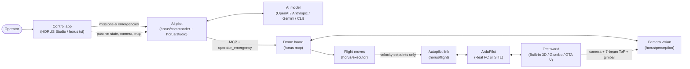

<div align="center">


# HORUS

**Safety-first, latency-tolerant autonomous drone supervision. Natural-language AI pilots backed by deterministic safety, onboard vision, and 3D simulation.**

[](https://horus-drone.github.io/horus/)
[](.github/workflows/ci.yml)
[](pyproject.toml)
[](pyproject.toml)

[Documentation](https://horus-drone.github.io/horus/) ·
[Quickstart](https://horus-drone.github.io/horus/getting-started/quickstart/) ·
[Safety Model](https://horus-drone.github.io/horus/concepts/safety-model/) ·
[MCP Tools](https://horus-drone.github.io/horus/reference/mcp-tools/) ·
[Credits & Licenses](https://horus-drone.github.io/horus/reference/credits-and-licenses/)

</div>

---

HORUS lets a natural-language **AI model** supervise an **ArduPilot** multirotor over unreliable or high-latency links without ever trusting the LLM with flight stability, obstacle avoidance, or emergency overrides. Run everything locally in **HORUS Studio** with a built-in 3D **Test world**, or connect directly to real hardware.

## Documentation

> [!TIP]
> **Full guides, installation scripts, hardware checklists, and API references live on the [HORUS Documentation Site](https://horus-drone.github.io/horus/).**

| Section | Guides |
| --- | --- |
| **Getting Started** | [Installation](https://horus-drone.github.io/horus/getting-started/installation/) · [Quickstart](https://horus-drone.github.io/horus/getting-started/quickstart/) · [AI Providers & Crew](https://horus-drone.github.io/horus/getting-started/ai-providers/) |
| **Core Concepts & Safety** | [Architecture](https://horus-drone.github.io/horus/concepts/architecture/) · [Safety Model](https://horus-drone.github.io/horus/concepts/safety-model/) · [Vision & Latency](https://horus-drone.github.io/horus/concepts/vision-and-latency/) |
| **Simulation Worlds** | [Built-in 3D World](https://horus-drone.github.io/horus/simulation/builtin-3d/) · [Gazebo Harmonic](https://horus-drone.github.io/horus/simulation/gazebo/) · [GTA V Integration](https://horus-drone.github.io/horus/simulation/gta-v/) |
| **Hardware & Field Ops** | [Companion Setup](https://horus-drone.github.io/horus/hardware/companion-setup/) · [Pre-flight & Testing](https://horus-drone.github.io/horus/hardware/preflight-and-testing/) · [Phone Companion App](https://horus-drone.github.io/horus/hardware/phone-app/) |
| **Reference** | [MCP Drone Board Tools](https://horus-drone.github.io/horus/reference/mcp-tools/) · [CLI & Configuration](https://horus-drone.github.io/horus/reference/cli-and-config/) · [Experiments & Logs](https://horus-drone.github.io/horus/reference/experiments/) · [Credits & Licenses](https://horus-drone.github.io/horus/reference/credits-and-licenses/) |

## Quickstart

### One-line install (recommended)

No Python, `uv`, or `git` needed. Installs HORUS, downloads SITL & vision models, and launches **HORUS Studio**:

**Windows (PowerShell):**

```powershell
irm https://horus-drone.github.io/horus/install.ps1 | iex
```

**Linux / macOS:**

```sh
curl -LsSf https://horus-drone.github.io/horus/install.sh | sh
```

### Development install (from a local clone)

Clone the repository, then expand your OS below:

<details>
<summary><strong>Windows (PowerShell)</strong></summary>

**With [`uv`](https://docs.astral.sh/uv/getting-started/installation/) (recommended):**

```powershell
uv sync --python 3.12
uv run horus
```

Or activate `.venv` once so you can run `horus` and `pytest` directly without `uv run`:

```powershell
.\.venv\Scripts\Activate.ps1
horus
```

**With `pip` (Python 3.10–3.13):**

```powershell
python -m venv .venv
.\.venv\Scripts\Activate.ps1
pip install -e .
horus
```

</details>

<details>
<summary><strong>Linux / macOS</strong></summary>

**With [`uv`](https://docs.astral.sh/uv/getting-started/installation/) (recommended):**

```sh
uv sync --python 3.12
uv run horus
```

Or activate `.venv` once so you can run `horus` and `pytest` directly without `uv run`:

```sh
source .venv/bin/activate
horus
```

**With `pip` (Python 3.10–3.13):**

```sh
python3 -m venv .venv
source .venv/bin/activate
pip install -e .
horus
```

</details>

`horus` launches **HORUS Studio** with zero Docker, Gazebo, GStreamer, or hand-edited YAML required. Pick **Indoor SAR Room**, **Outdoor Forest**, **Urban Plaza**, **Procedural World**, or **Real Drone** in one click.

### CLI commands

```sh
# Web dashboard (default when running `horus` alone)
horus                             # Start HORUS Studio and open it in your browser
horus studio --port 8765          # Choose a custom port (optional: --no-browser, --phone)

# Terminal client & standalone Drone board
horus tui                         # Interactive terminal control app (--server-url, --config)
horus mcp                         # Run the Drone board MCP server (--no-perception for flight-only)

# Setup & diagnostics
horus setup                       # Download and verify SITL and vision models (--check, --with-grounder)
horus doctor                      # Check Python, MuJoCo, SITL, models, serial ports, and AI keys (--json)

# Help
horus --help                      # List all commands (short form: horus -h)
horus <command> --help            # Show options for a specific command (e.g. horus studio --help)
```

See the [CLI & Configuration reference](https://horus-drone.github.io/horus/reference/cli-and-config/) for standalone entrypoints, YAML profiles, HTTP/SSE APIs, and environment variables.

## Highlights

- **Standalone 3D Test world:** Cross-platform Python/MuJoCo 3D simulation running real ArduCopter 4.7.1 SITL (`--model JSON`), 7-beam ToF proximity avoidance, stabilized 2-axis gimbal, textured SAR scenes, and an AprilTag `tag36h11` precision landing pad.
- **HORUS Studio Control app:** Unified web dashboard with live annotated camera, 3D spectator view, offline-capable Tactical 2D Map, Fault Lab (latency and AI link-cut simulator), Manual Flight Pad, and multi-provider AI setup (OpenAI, Anthropic, Gemini, OpenRouter, Ollama, Claude Code CLI, OMP).
- **Latency-tolerant Camera vision:** Onboard YOLOv8n + OSNet ReID set-of-mark numbered targets, CSRT ring-buffer fast-forward compensation (`point()`), scene motion/region watches, and optional open-vocabulary grounding (`horus-grounder`).
- **Bench to field:** Connect USB/telemetry radios directly in Studio, deploy `horus mcp` (`pip install -e ".[board]"`) on companion computers, attach Gazebo Harmonic or GTA V, or install the Tailscale phone PWA (`/?view=phone`).

## Architecture



> **Design reference:** See [HORUS Design Document v2](HORUS%20%E2%80%94%20Design%20Document%20v2.md) for full block contracts and [PLAN.md](PLAN.md) for phased roadmap status.

## Safety Principles

1. **One base move at a time:** The **AI model** selects one move (`take_off`, `goto`, `move`, `turn`, `look`, `hold`, `land`, `rth`). No autonomous search or chase loop runs behind the scenes.
2. **Velocity setpoints & deterministic avoidance:** **Autopilot link** sends `GUIDED` velocity setpoints only; **ArduPilot** enforces proximity braking via 7-beam ToF `DISTANCE_SENSOR` (`AVOID_ENABLE`). No artificial geofence is imposed.
3. **Instant operator priority:** `HOLD`, `LAND`, and `HOME` bypass the **AI pilot**, interrupt active model turns, and lock out AI flight tools (`operator_lock`) until your next mission. Hardware RC `PILOT` override always wins.
4. **AI link-loss failsafe:** If the **AI model** or **AI pilot** goes quiet past `link_loss_rth_delay_s` (default 30 s), **Flight moves** holds and triggers `auto_rth`. Passive UI reads never keep the watchdog alive.

## Project Structure

```text
horus/
├── horus/                  # Main Python package
│   ├── cli.py              # `horus` CLI (studio, tui, mcp, setup, doctor)
│   ├── bootstrap.py        # ArduCopter SITL + YOLOv8n/OSNet asset fetcher & doctor
│   ├── studio/             # HORUS Studio supervisor, settings/secrets, preflight & Fault Lab
│   ├── commander/          # AI pilot backend, ASGI/SSE server & built UI (`web/`)
│   ├── repl/               # Terminal Control app (`horus tui`)
│   ├── mcp_server/         # Drone board MCP HTTP server (`horus mcp`)
│   ├── executor/           # Flight moves engine (single move, watchdog, operator_lock, auto_rth)
│   ├── flight/             # Autopilot link (MAVLink velocity setpoints & ArduPilot interface)
│   ├── perception/         # Camera vision (YOLOv8n + OSNet ReID, Set-of-Mark, CSRT, AprilTag)
│   ├── grounder/           # Optional open-vocabulary grounding service (Grounding DINO / OWLv2)
│   ├── gimbal/             # 2-axis gimbal stabilization & pointing
│   ├── tof_bridge/         # 7-beam ToF proximity bridge
│   ├── maps/ & own_map.py  # Offline tactical 2D maps & operator marks
│   └── world/              # Built-in Python/MuJoCo 3D Test world (4 scenes + JSON SITL runner)
│
├── ui/                     # React + TypeScript + Tailwind CSS + Vite source for HORUS Studio
├── site/                   # Astro Starlight documentation website + install.sh / install.ps1
├── config/                 # YAML flight & sim profiles (horus.yaml, horus_gta.yaml, horus_nogps.yaml, ...)
├── sim/                    # Optional Docker + Gazebo Harmonic + ArduPilot SITL stack
├── gta/                    # Optional GTA V (Windows) bridge/mod for photorealistic simulation
├── scripts/                # Utilities (phone_serve.sh, sync_icons.mjs, start_grounder.sh, netem.sh, ...)
├── tests/                  # Pytest suite (world physics, Studio API, safety executor, MCP, CLI)
├── docs/                   # Course & PAF project deliverables (separate from Starlight site)
├── .github/workflows/      # CI (`ci.yml`), docs deploy (`docs.yml`), asset releases (`release-assets.yml`)
├── pyproject.toml          # Package metadata, dependencies & optional extras (`[board]`, etc.)
└── PLAN.md                 # Phased roadmap & block tracking
```

## License & Credits

HORUS is released under the **MIT License**. Third-party AI vision checkpoints (such as `Kalray/yolov8` under **AGPL-3.0** and `OSNet` under **MIT**), map datasets (OpenStreetMap **ODbL**), and Gazebo Fuel 3D simulation assets carry their own upstream licenses and attributions; see **[Credits & Licenses](https://horus-drone.github.io/horus/reference/credits-and-licenses/)** for full details.
